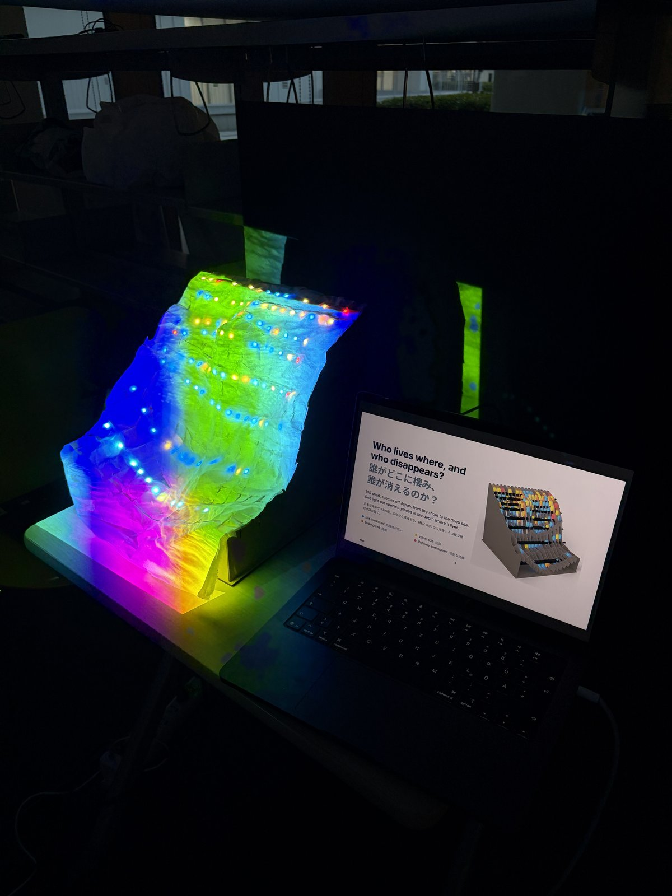
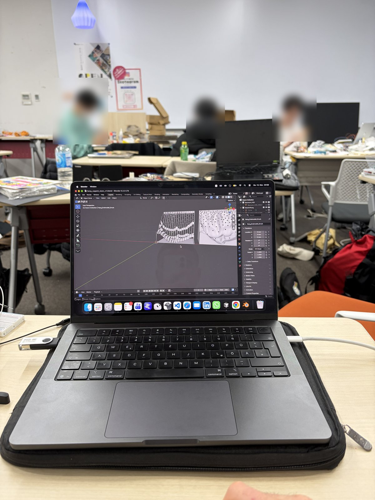
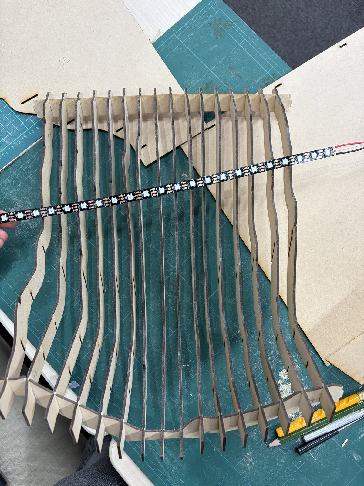
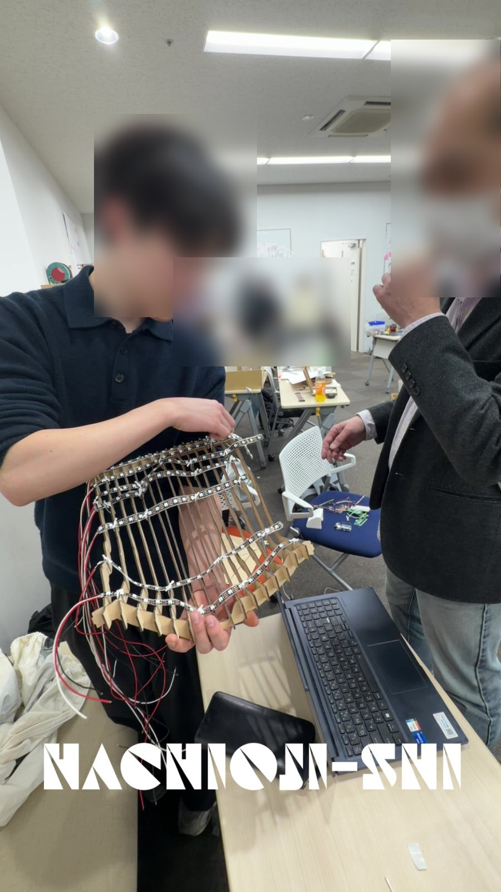
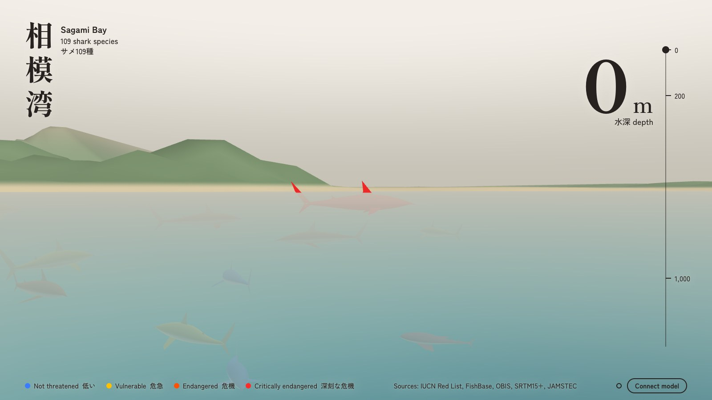
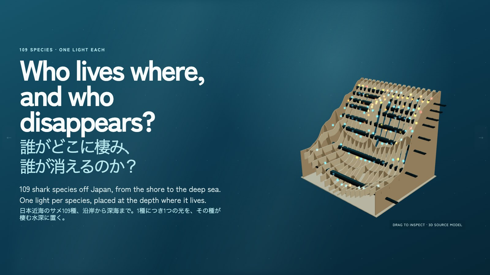

<div align="center">

# Who lives where, and who disappears?

**誰がどこに棲み、誰が消えるのか？**

109 shark species of Sagami Bay, Japan. One light per species, at the depth where it lives,<br>
coloured by its IUCN Red List status. Built during Muros Week Tokyo 2026.


[The object](#the-object) · [Process](#process) · [Digital side](#digital-side) · [Run it](#run-it) · [Release](../../releases/tag/v1.0) · [Deck (PDF)](docs/who-disappears.pdf)



</div>

## At a glance

| | |
|---|---|
| **109** | shark species, one addressable LED each |
| **46** | of them threatened (Red List: vulnerable, endangered or critically endangered) |
| **19.3 km** | real seabed transect of Sagami Bay, from the coast down to **1,305 m** |
| **1 cm = 125.6 m** | model height to water depth |
| **18 + 5** | laser-cut profile pieces and slotted cross bands, 2 mm wood |
| **8** | LED strands, driven by one Arduino UNO R4 WiFi |

## The object

- **Height is depth.** The model follows a real seabed transect of Sagami Bay (SRTM15+): 19.3 km from the coast down to 1,305 m.
- **Colour is threat.** Blue: not threatened (63 species). Yellow: vulnerable (23). Orange: endangered (19). Red: critically endangered (4).
- **Threatened sharks live shallower.** The median depth of the not-threatened species is 408 m; for vulnerable and endangered species it is 100 m, for critically endangered ones 85 m.

### The light cycle: "Who disappears"

1. **All lights on.** For 30 seconds all 109 species glow in their Red List colour.
2. **Threatened species blink.** The 46 yellow, orange and red species blink three times. Blue stays on.
3. **They go dark, one by one.** Red goes dark first, then orange, then yellow. Only the 63 blue species remain, then all lights return.

A thought experiment, not a forecast.

## Process

From a seabed dataset to a lit wooden object in seven steps.

| | |
|---|---|
|  | **1. First approach: a 3D print.** The seabed profile became a solid slope with LED holes, sliced for a Bambu printer at 1:3 as a hollow prototype. The final object moved to a laser-cut lattice instead, with the LEDs sitting between the boards. |
|  | **2. Seabed to 3D.** Blender turns the Sagami Bay profile into a walled slope with 109 light positions. Python scripts sample its surface on a 0.5 mm grid and cut it into profile boards with slots for cross bands. |
|  | **3. Laser cutting.** 18 profile pieces of 2 mm wood, held together by 5 slotted cross bands, nested on five 600 × 300 mm boards. A test strip with slot widths from 1.7 to 2.2 mm is cut first to match the slot to the real board thickness. |
|  | **4. Lattice and light.** The assembled lattice: 16 profile rails plus the two side plates. One addressable WS2812B LED per species. |
|  | **5. Eight strands.** The LEDs run in 8 strands (S1 at the top down to S8 in the deep sea), each across the rails, so every species sits at its habitat depth. |
|  | **6. Wiring and test.** An Arduino UNO R4 WiFi drives the 8 strands from pins 2 to 9, with a 5 V supply. On power-up a self-test lights 1 LED on S1, 2 on S2, up to 8 on S8. |
|  | **7. Exhibit.** The lit model next to the presentation. A screen visualization can run beside it and steer the board over USB. |

## Digital side

**Screen visualization** ([`web/`](web/)). A loop in two chapters: the camera starts above Sagami Bay and sinks along the slope, stopping at seven real species from the scalloped hammerhead to the leafscale gulper shark at their depth; then it plays the act "Who disappears" in step with the LEDs. In Chrome the page connects to the board over Web Serial and steers the light cycle.



**Presentation** ([`presentation/`](presentation/)). A self-contained bilingual deck with the laser model as an interactive 3D view. Four slides, also as [PDF](docs/who-disappears.pdf).



## How it is built

```
SRTM15+ grid ──> modell/fetch_sagami.py ──> sagami_profil.csv ──> modell/land_sagami.py ──> sagami_land.csv
                                                    │
hang_sagami_final.blend ──> modell/baue_endmodell_v4.py (Blender) ──> walled v4 model + led_positionen_v4.csv
                                                    │
hang_sagami_endmodell_v4_mit_waenden.blend ──> modell/laser_abtasten.py (Blender) ──> oberflaeche_05mm.npz
                                                    │
modell/laser_schnitte.py ──> brett_01..05.svg, schlitz_testleiste.svg, teile_3d.json, led_montage.csv
  ├─ modell/laser_zusammenbau.py (Blender) ──> hang_sagami_laser_v1.blend, assembly check
  ├─ modell/led_reihen_modell.py ──> 8 LED strands, carrier STLs, arduino/hai_zeitreise/acht_straenge_map.h
  ├─ modell/laser_pdf.py, laser_anleitung_pdf.py, led_reihen_pdf.py ──> cut PDFs and guides
  └─ modell/laser_lieferung.py ──> delivery folder for the laser shop

hai_tiefenmodell_master.csv ──> scripts/build_web_daten.py ──> web/src/data/*.json
                            ──> scripts/build_kueste.py    ──> web/src/data/kueste.json
                            ──> scripts/pruefe_led_daten.py (consistency check of LEDs and species)
```

`data/processed/hai_tiefenmodell_master.csv` is the curated species table (species, order, Red List category, depth, LED id). It was assembled by hand from the sources below and is not generated by a script.

### Repository layout

```
data/
  processed/        curated species table, names, LED time series, seabed profile, land profile
  raw/bathymetrie/  SRTM15+ height grid of Sagami Bay
scripts/            data steps for the web view and the Arduino (Python)
modell/             Blender and laser pipeline (Python, partly run inside Blender)
  export/laser_v1/  cut files (SVG and PDF), parts lists, assembly guides, LED carrier STLs
arduino/
  hai_zeitreise/    the sketch (FastLED, 8 strands, 109 LEDs)
  host_test/        host-side test of the serial remote parser
web/                screen visualization (Astro, Three.js, GSAP, Tailwind)
presentation/       self-contained HTML deck with the interactive 3D model
docs/               deck PDF, process photos and screenshots
```

## Run it

### Python data steps

```sh
python3 -m venv .venv && .venv/bin/pip install -r requirements.txt
.venv/bin/python scripts/pruefe_led_daten.py     # checks 109 LEDs against the species table
.venv/bin/python scripts/build_web_daten.py      # rebuilds web/src/data/{arten,hang,zeitreihe}.json
.venv/bin/python scripts/build_kueste.py         # rebuilds web/src/data/kueste.json
.venv/bin/python modell/laser_schnitte.py        # rebuilds the laser cut files
```

`scripts/build_zeitreihe_led.py` also needs `pdftotext` (Poppler) and the ISC 2022 blue shark assessment PDF in `data/raw/isc/`, which is not part of this repository. Its output, `data/processed/hai_zeitreihe_led.csv` and `arduino/hai_zeitreise/zeitreihe.h`, is committed.

### Blender steps

The three `.blend` files are attached to the [v1.0 release](../../releases/tag/v1.0). Put them into `modell/` and run, for example:

```sh
/Applications/Blender.app/Contents/MacOS/Blender -b modell/hang_sagami_endmodell_v4_mit_waenden.blend --python modell/laser_abtasten.py
```

| File | Used by |
|---|---|
| `hang_sagami_final.blend` | input of `modell/baue_endmodell_v4.py` |
| `hang_sagami_endmodell_v4_mit_waenden.blend` | input of `modell/laser_abtasten.py` and `modell/laser_zusammenbau.py` |
| `hang_sagami_laser_v1.blend` | the final lattice model, input of `presentation/source/export_model.py` |

### Arduino

Board: Arduino UNO R4 WiFi (UNO R3 also compiles). Library: FastLED.

```sh
arduino-cli compile --fqbn arduino:renesas_uno:unor4wifi arduino/hai_zeitreise
bash arduino/host_test/run.sh                    # tests the serial remote parser on the host
```

### Web visualization

```sh
cd web
npm install
npm run dev        # local server
npm test           # vitest
npm run build      # static build in web/dist
```

### Presentation

Open `presentation/index.html` in a current browser. No server, build step or network access needed. Details in [`presentation/README.md`](presentation/README.md).

## Data sources

- **Seabed and land:** SRTM15+ global bathymetry and topography (Tozer et al., 2019).
- **Red List status:** IUCN Red List of Threatened Species.
- **Depth:** OBIS occurrence records, otherwise FishBase or Wikipedia.
- **Common names:** Wikipedia (English and Japanese).
- **Stock time series:** RAM Legacy Stock Assessment Database v4.61 (CC BY 4.0) and ISC stock assessments.

## Licence

Code (Python, Arduino, web, presentation scripts) is released under the [MIT licence](LICENSE). Photos, screenshots, cut files, model files and the deck are released under [CC BY 4.0](https://creativecommons.org/licenses/by/4.0/). Third-party data keeps its original licence and terms. The bundled fonts in `presentation/assets/` (Zen Kaku Gothic New) are under the SIL Open Font License, see [`presentation/assets/OFL.txt`](presentation/assets/OFL.txt).

Faces in the process photos are blurred.
